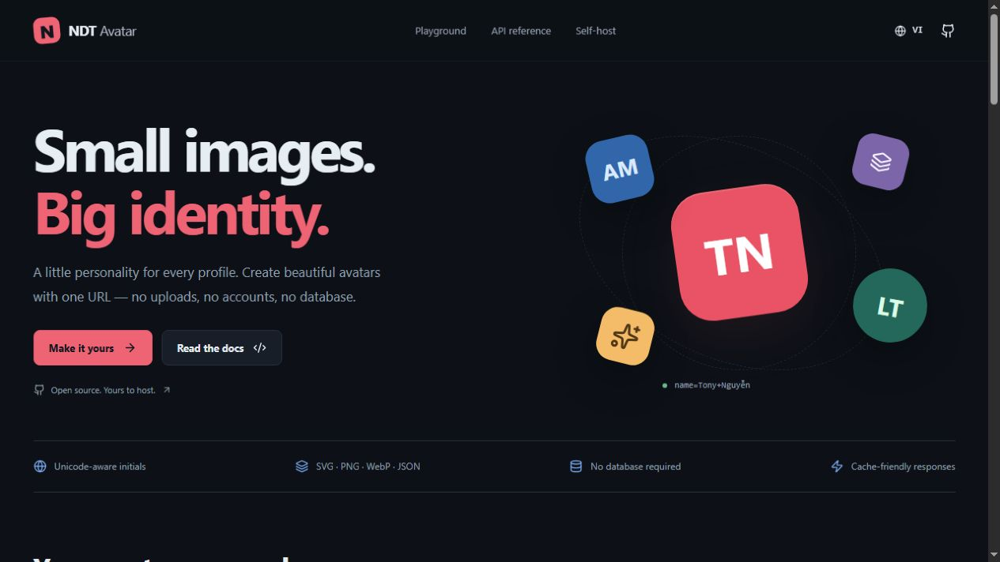

<div align="center">

# 🎨 NDT Avatar

### Ảnh nhỏ. Dấu ấn lớn.

[](https://www.php.net/)
[](https://nextjs.org/)
[](https://github.com/nguyenduytan/NDT-Avatar/actions)
[](LICENSE)

[English](README.md) · **Tiếng Việt** · [Website](https://nguyenduytan.com)

</div>

<p align="center"></p>

<h2 align="center">✨ Tính năng</h2>

API tạo avatar không cần cơ sở dữ liệu, dùng PHP 8.4 trở lên. Giao diện Next.js có tiếng Anh và tiếng Việt, xuất thành website tĩnh để VPS không phải chạy Node thường trực.

- Chữ cái đầu hỗ trợ tiếng Việt và chuẩn hóa Unicode NFC.
- Ba kiểu: chữ cái, identicon đối xứng và vòng tròn hình học.
- Bốn định dạng SVG, PNG, WebP và JSON; kích thước 16–2048 pixel.
- Màu theo tên, màu tùy chỉnh, tương phản tự động, gradient, nền trong suốt và bo góc.
- Playground trực tiếp, sáu preset màu, tải ảnh và sao chép URL/HTML/Markdown/cURL/JavaScript.
- Xuất danh sách URL cho tối đa 100 tên ngay trong trình duyệt.
- Kiểm tra đầu vào, escape SVG, CORS, ETag/304, HEAD/OPTIONS.
- Docker Compose, healthcheck, Nginx cache tối đa 256 MB, giới hạn request theo IP.

<h2 align="center">🚀 Chạy nhanh</h2>

```bash
git clone https://github.com/nguyenduytan/NDT-Avatar.git
cd NDT-Avatar
cp .env.example .env
docker compose up -d --build --wait
```

Mở http://localhost:8080/vi/. Mặc định chỉ bind localhost; khi public trên VPS hãy cấu hình HTTPS theo [hướng dẫn](docs/DEPLOYMENT.md).

```bash
curl --fail 'http://localhost:8080/api/v1/avatar?name=Tony+Nguyen&format=png&background=e95365&color=fff' -o avatar.png
```

<h2 align="center">🔌 API và phát triển</h2>

Endpoint chính: `/api/v1/avatar`. Alias: `/api/`, `/api/index.php`. Kiểm tra hoạt động: `/health`; thông tin khả năng: `/api/v1/meta`.

[README tiếng Anh](README.md#-api-reference) có bảng đầy đủ tham số, ví dụ và biến môi trường. Giao diện `/vi/` có tài liệu API bằng tiếng Việt. [OpenAPI](web/public/openapi.json) dùng để tích hợp công cụ.

Yêu cầu local: PHP 8.4+ có GD/FreeType, intl, mbstring; Node 22+ và npm. Không cần cài Composer package để chạy API.

```bash
# Terminal 1
php -S 127.0.0.1:8091 api/router.php
# Terminal 2
cd web
npm ci
npm run build
cd ..
node scripts/preview.mjs
```

Mở http://127.0.0.1:3000/vi/. Trên Windows có thể thêm `-d extension=gd` vào lệnh PHP nếu GD chưa bật.

```bash
php api/tests/run.php
node scripts/smoke.mjs
cd web
npm run lint
npm run typecheck
npm run build
```

Tên được xử lý trong request, không lưu hồ sơ. Cache tùy chọn lưu ảnh; URL có thể chứa tên nên cần cân nhắc log ở proxy. SVG dùng font trên máy xem; PNG/WebP dùng Noto Sans kèm dự án. Emoji và hệ chữ ngoài phạm vi font không được bảo đảm. Tham số sai trả 400 thay vì tự điều chỉnh; không hỗ trợ tham số theo vị trí trong path.

<h2 align="center">📊 Thống kê</h2>

<div align="center">

**Cập nhật: 26/10/2026**

4 định dạng · 3 kiểu avatar · 2 ngôn ngữ · 6 preset

24 kiểm tra core · 18 kiểm tra HTTP

</div>

Đây là số liệu chức năng và kiểm tra trong source, không phải số người dùng hay benchmark. Kiểm tra local chạy PHP 8.5.1 và Node 24; CI được cấu hình cho PHP 8.4/8.5 và Docker.

<h2 align="center">📚 Tài liệu</h2>

[Triển khai VPS](docs/DEPLOYMENT.md) · [Đóng góp](CONTRIBUTING.md) · [Bảo mật](SECURITY.md) · [Changelog](CHANGELOG.md) · [MIT](LICENSE)

<div align="center">

© 2026 NDT Avatar · Made with ❤️ by [Tony Nguyễn](https://nguyenduytan.com)

[Website](https://nguyenduytan.com) · [GitHub](https://github.com/nguyenduytan/NDT-Avatar)

</div>
